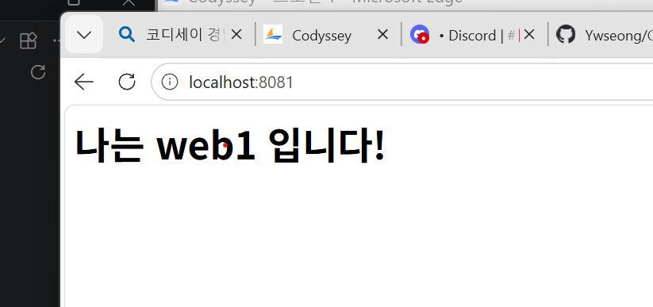
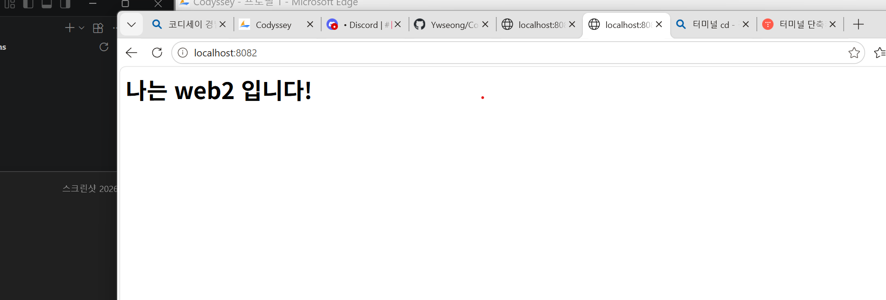

# codyssey-e1-1
개발자용 작업실 꾸미기
# 📌 1. 프로젝트 개요 (미션 목표)

Windows 환경에서 Docker를 활용한 개발환경을 구축하고,
터미널 조작 · 파일 권한 · 커스텀 이미지 빌드 · 포트 매핑 ·
볼륨 영속성 · Docker Compose · Git/GitHub 연동을 실습한다.

**학습 목표**
- 절대/상대 경로의 차이 이해
- 파일 권한(r/w/x, 755/644) 해석
- Dockerfile 기반 커스텀 이미지 빌드
- 포트 매핑의 필요성 이해
- Docker 볼륨(영속 데이터) 이해
- Git(로컬 버전관리) vs GitHub(원격 협업) 역할 구분
- 설정과 코드의 분리(환경 변수)

---

## 💻 2. 실행 환경

| 항목 | 버전/정보 |
|------|-----------|
| OS | Windows (버전: 11) |
    Ubuntu: 26.04
| 터미널 | VSCode Terminal |
| Docker | 29.9.2 |
| Git | 2.56.0.windows.4 |

```powershell
# 버전 확인 명령
docker --version
git --version
```

---

## ✅ 3. 수행 항목 체크리스트

- [] 터미널 조작 (PowerShell 경로 이동, ls 등)
- [] 파일 권한 실습 (chmod 755/644)
- [] Docker 설치 및 점검 (docker --version, docker info)
- [] Dockerfile 커스텀 이미지 빌드 (my-web:1.0)
- [] 포트 매핑 (8081/8082/8083)
- [] 바인드 마운트 반영 확인
- [] Docker 볼륨 영속성 검증 (my-vol)
- [] Docker Compose 멀티 서비스 (web1/web2)
- [] 환경 변수 분리 (.env)
- [] Git 설정 및 GitHub 연동

---
## 3-1. 학습 목표 (성취 기준)

### ✅ 절대 경로 vs 상대 경로
- **절대 경로**: 최상위(루트)부터 시작하는 전체 경로. 어디서 실행하든 같은 위치를 가리킴.
  - 예) `C:\Users\사용자\test\compose-basic\Dockerfile`
- **상대 경로**: 현재 작업 폴더 기준의 경로.
  - 예) `.\compose-basic` (현재 폴더 하위), `..\` (상위 폴더)
- 💡 `docker build -t my-web:1.1 .` 의 `.` 은 "현재 폴더"를 뜻하는 상대 경로.

### ✅ 파일 권한 (r/w/x)과 숫자 표기
- **r(읽기)=4, w(쓰기)=2, x(실행)=1** → 더해서 표현
- 순서는 **소유자 / 그룹 / 기타 사용자** 3자리
- 예)
  - `755` = `rwx r-x r-x` → 소유자는 모든 권한, 나머지는 읽기+실행
  - `644` = `rw- r-- r--` → 소유자는 읽기+쓰기, 나머지는 읽기만
- 💡 실습: `chmod 755`, `chmod 644` 로 권한 변경 확인

### ✅ 커스텀 이미지 빌드
- 기존 베이스 이미지(예: `nginx`)를 바탕으로 Dockerfile을 작성해
  내 설정이 포함된 이미지를 만들 수 있음.
- 예) `docker build -t my-web:1.1 .`
- 💡 `:1.0`, `:1.1` 처럼 태그로 버전 관리 가능

### ✅ 포트 매핑이 필요한 이유
- 컨테이너는 **격리된 독립 네트워크**를 가짐.
- 호스트(내 PC)에서 접근하려면 `호스트포트:컨테이너포트` 연결이 필요.
  - 예) `-p 8081:80` → 내 PC의 8081 → 컨테이너의 80번 포트로 전달
- 💡 포트가 겹치면 충돌 발생 → 서로 다른 호스트 포트(8081/8082/8083) 사용

### ✅ Docker 볼륨 (영속 데이터)
- 컨테이너는 삭제되면 내부 데이터도 사라짐.
- **볼륨**을 쓰면 데이터를 컨테이너 바깥에 저장해 **영속**시킬 수 있음.
  - 예) `docker volume create my-vol`
- 💡 실습: 컨테이너 삭제 후 재생성해도 데이터 유지 확인

### ✅ Git vs GitHub
- **Git**: 내 PC에서 돌아가는 **로컬 버전관리 도구** (변경 이력 기록).
- **GitHub**: Git 저장소를 올려 공유·협업하는 **원격 플랫폼**.
- 💡 `git commit`(로컬 기록) → `git push`(GitHub로 업로드)

## 🔍 4. 검증 방법 및 결과

### 4-1. Docker 설치 점검
```powershell
docker --version
docker info
```
**결과:** 
PS C:\Users\dktktkddhks4830\test\codyssey-e1-1> docker --version
Docker version 29.9.2, build a82e528
PS C:\Users\dktktkddhks4830\test\codyssey-e1-1> docker info
Client:
 Version:    29.9.2
 Context:    desktop-linux
 Debug Mode: false

### 4-2. Docker 운영/검증 로그
```powershell
docker images       # 이미지 목록
docker ps -a        # 모든 컨테이너 상태
docker logs <컨테이너명>
docker stats        # 리소스 사용량
```
**결과:** 
PS C:\Users\dktktkddhks4830\test\codyssey-e1-1> docker images
                                                                             i Info →   U  In Use
IMAGE                  ID             DISK USAGE   CONTENT SIZE   EXTRA
hello-world:latest     c567b231f656       25.9kB         9.49kB    U   
my-web-server:latest   e55af6a89bed       93.6MB         26.3MB    U   
my-web:1.0             9dba56266bc9       93.6MB         26.3MB        
nginx:alpine           785835ea65db       94.5MB         27.2MB    U   
ubuntu:latest          6a06111c3b0a        163MB         45.9MB    U   
PS C:\Users\dktktkddhks4830\test\codyssey-e1-1> docker ps -a
CONTAINER ID   IMAGE           COMMAND                   CREATED          STATUS                  PORTS                                     NAMES
5b2251c71663   nginx:alpine    "/docker-entrypoint.…"   40 minutes ago   Up 40 minutes           0.0.0.0:8082->80/tcp, [::]:8082->80/tcp   compose-basic-web2-1
956f59d3bf5b   nginx:alpine    "/docker-entrypoint.…"   40 minutes ago   Up 40 minutes           0.0.0.0:8081->80/tcp, [::]:8081->80/tcp   compose-basic-web1-1
272bc50ab807   ubuntu          "bash"                    4 days ago       Exited (0) 4 days ago                                             sad_yalow
fe6ee291dfc4   ubuntu          "/bin/bash"               4 days ago       Exited (0) 4 days ago                                             jovial_mayer
cf66d1d593c9   hello-world     "/hello"                  4 days ago       Exited (0) 4 days ago                                             nice_margulis
26453bf19c07   my-web-server   "/docker-entrypoint.…"   5 days ago       Up 4 hours              0.0.0.0:8080->80/tcp, [::]:8080->80/tcp   my-container
ba17424b6899   hello-world     "/hello"                  5 days ago       Exited (0) 5 days ago                                             nervous_golick
PS C:\Users\dktktkddhks4830\test\codyssey-e1-1> docker logs compose-basic-web1-1
/docker-entrypoint.sh: /docker-entrypoint.d/ is not empty, will attempt to perform configuration
/docker-entrypoint.sh: Looking for shell scripts in /docker-entrypoint.d/
/docker-entrypoint.sh: Launching /docker-entrypoint.d/10-listen-on-ipv6-by-default.sh
10-listen-on-ipv6-by-default.sh: info: Getting the checksum of /etc/nginx/conf.d/default.conf
10-listen-on-ipv6-by-default.sh: info: Enabled listen on IPv6 in /etc/nginx/conf.d/default.conf
/docker-entrypoint.sh: Sourcing /docker-entrypoint.d/15-local-resolvers.envsh
/docker-entrypoint.sh: Launching /docker-entrypoint.d/20-envsubst-on-templates.sh
/docker-entrypoint.sh: Launching /docker-entrypoint.d/30-tune-worker-processes.sh
/docker-entrypoint.sh: Configuration complete; ready for start up
PS C:\Users\dktktkddhks4830\test\codyssey-e1-1> docker stats
CONTAINER ID   NAME                   CPU %     MEM USAGE / LIMIT     MEM %     NET I/O          BLOCK I/O        PIDS
5b2251c71663   compose-basic-web2-1   0.00%     20.04MiB / 15.25GiB   0.13%     3.8kB / 1.61kB   0B / 12.3kB      25
956f59d3bf5b   compose-basic-web1-1   0.00%     19.32MiB / 15.25GiB   0.12%     1.75kB / 126B    0B / 12.3kB      25
26453bf19c07   my-container           0.00%     22.92MiB / 15.25GiB   0.15%     2.22kB / 126B    9.66MB / 4.1kB   25
---

## 🐳 5. Dockerfile 기반 웹 서버 컨테이너

### 5-1. 디렉터리 구조
```
compose-basic/
├── docker-compose.yml
├── .env
├── html1/
└── html2/
```

### 5-2. Dockerfile
```dockerfile
FROM nginx:alpine
COPY index.html /usr/share/nginx/html/index.html

```

### 5-3. 빌드 & 실행
```powershell
docker build -t my-web:1.1 .
docker run -d -p 8083:80 my-web:1.1
```
**결과:** 
PS C:\Users\dktktkddhks4830\test\codyssey-e1-1> docker build -t my-web:1.1 .                
[+] Building 0.2s (7/7) FINISHED                                             docker:desktop-linux
 => [internal] load build definition from Dockerfile                                         0.0s
 => => transferring dockerfile: 106B                                                         0.0s
 => [internal] load metadata for docker.io/library/nginx:alpine                              0.0s
 => [internal] load .dockerignore                                                            0.0s
 => => transferring context: 2B                                                              0.0s
 => [internal] load build context                                                            0.0s
 => => transferring context: 32B                                                             0.0s
 => [1/2] FROM docker.io/library/nginx:alpine@sha256:785835ea65db4bba6f021acc0f3be91b0fef76  0.0s
 => => resolve docker.io/library/nginx:alpine@sha256:785835ea65db4bba6f021acc0f3be91b0fef76  0.0s
 => CACHED [2/2] COPY index.html /usr/share/nginx/html/index.html                            0.0s
 => exporting to image                                                                       0.1s
 => => exporting layers                                                                      0.0s
 => => exporting manifest sha256:429c5b036bbed6775bff7796742a939a2a9fa26e30d7f3ff68d8154360  0.0s
 => => exporting config sha256:7ba611d452e6662e91ca63649e5cb98d4989afc92a32839bcdae1b38cbef  0.0s
 => => exporting attestation manifest sha256:4d8493cf9fc13ee7ac99dfb8fc1af7631c916c03341157  0.0s
 => => exporting manifest list sha256:939952c75534558c805cc34fe146205142adc561add3341a05ca2  0.0s
 => => naming to docker.io/library/my-web:1.1                                                0.0s
 => => unpacking to docker.io/library/my-web:1.1                                             0.0s
PS C:\Users\dktktkddhks4830\test\codyssey-e1-1> docker run -d -p 8083:80 my-web:1.1
73e2a9d2f2e34f763ca379da315edddf8bb86acc5d386f6d2549790cec670a63
위 포트 매핑과 포트 주소가 다른이유는 화면 캡처를 못하고 넘어가서 새로 만들어서 다릅니다
---

## 🌐 6. 포트 매핑 접속 증거

```powershell
docker run -d -p 8081:80 nginx:alpine
```

- 포트 매핑: `호스트포트:컨테이너포트`
- 브라우저 접속: `http://localhost:8081`

**접속 화면 (주소창 포함):**


> 💡 **포트 매핑이 필요한 이유:** 컨테이너는 격리된 네트워크를 가지므로,
> 외부(호스트)에서 접속하려면 호스트 포트와 컨테이너 포트를 연결해야 한다.

---

## 📂 7. 바인드 마운트 + 볼륨 영속성 증거

### 7-1. 바인드 마운트
```powershell
docker run -d -p 8081:80 -v [호스트경로]:/usr/share/nginx/html nginx:alpine
```
- **변경 전:** `[스크린샷]`
- **호스트 파일 수정 후:** `[스크린샷]` ← 즉시 반영 확인

### 7-2. Docker 볼륨 영속성
```powershell
docker volume create my-vol              # 생성
docker run -d -v my-vol:/data nginx:alpine   # 연결
# 데이터 작성 후 컨테이너 삭제
docker rm -f <컨테이너명>
# 새 컨테이너에서 같은 볼륨 연결 → 데이터 유지 확인
```
- 
  ← 데이터 유지됨

> 💡 **볼륨이란:** 컨테이너와 독립적으로 데이터를 저장해,
> 컨테이너를 지워도 데이터가 남는 영속 저장소.

---

## 🔧 8. Docker Compose 멀티 서비스

### docker-compose.yml
```yaml
services:
  web1:
    image: nginx:alpine
    ports:
      - "${WEB1_PORT}:80"
    volumes:
      - ./html1:/usr/share/nginx/html

  web2:
    image: nginx:alpine
    ports:
      - "${WEB2_PORT}:80"
    volumes:
      - ./html2:/usr/share/nginx/html
```

### .env (설정과 코드 분리)
```
WEB1_PORT=8081
WEB2_PORT=8082
```

### 실행 & 확인
```powershell
docker compose up -d
docker compose ps
docker compose config    # 변수 치환 결과 확인
```
**결과:**  → localhost:8081, localhost:8082 접속 확인

---
## 9.파일 권한 실습 (Ubuntu 컨테이너)

Ubuntu 컨테이너에 접속하여 리눅스 파일 권한(chmod)을 실습했다.

### 1. Ubuntu 컨테이너 실행 및 진입
```bash
docker run -it ubuntu bash
-it 옵션으로 컨테이너 내부 bash에 접속한다.

2. 실습용 파일 생성
bash
📋 복사
touch test.txt
ls -l
ls -l로 파일의 현재 권한을 확인한다.

3. 권한 755 부여 (실행 파일용)
bash
📋 복사
chmod 755 test.txt
ls -l
소유자(user): 읽기+쓰기+실행 (rwx)
그룹(group): 읽기+실행 (r-x)
기타(other): 읽기+실행 (r-x)
4. 권한 644 부여 (일반 파일용)
bash
📋 복사
chmod 644 test.txt
ls -l
소유자(user): 읽기+쓰기 (rw-)
그룹(group): 읽기 (r--)
기타(other): 읽기 (r--)
권한 숫자의 의미
숫자	권한	의미
4	r (읽기)	read
2	w (쓰기)	write
1	x (실행)	execute
각 자리는 (소유자)(그룹)(기타) 순서이며,
숫자를 더해서 권한을 조합한다.
예) 7 = 4+2+1 = rwx, 6 = 4+2 = rw-, 5 = 4+1 = r-x
c:\Users\dktktkddhks4830\Pictures\Screenshots\스크린샷 2026-11-04 151708.png
c:\Users\dktktkddhks4830\Pictures\Screenshots\스크린샷 2026-11-04 153522.png
---

## ⚙️ 9. Git 설정 및 GitHub 연동

```powershell
git config --global user.name "[이름]"
git config --global user.email "[이메일]"
git config --global init.defaultBranch main
```
- VSCode에서 GitHub 로그인 및 저장소 연동 완료
- `[스크린샷]` (⚠️ 토큰/비밀번호는 가려서 첨부)

> 💡 **Git vs GitHub:** Git은 로컬에서 버전을 관리하는 도구,
> GitHub는 원격 저장소를 제공하는 협업 플랫폼.

---

## 🛠️ 10. 트러블슈팅

### 문제 1: 포트 충돌
- **문제:** `docker compose up` 시 8082 포트 충돌 발생
- **원인 가설:** 다른 컨테이너(my-web-container)가 8082를 점유
- **확인:** `docker ps -a`로 점유 컨테이너 발견
- **해결:** 점유 컨테이너 삭제 후 `down` → `up`으로 재생성

### 문제 2: 포트 매핑 미반영
- **문제:** compose config엔 8082가 있는데 컨테이너엔 매핑 안 됨
- **원인 가설:** `up -d`가 기존 컨테이너를 **재사용**하여 설정 미반영
- **확인:** `docker compose ps`에서 `80/tcp`만 표시됨
- **해결:** `docker compose down` 후 `up -d`로 컨테이너 새로 생성

### 문제 3: PowerShell 경로 문법 / 폴더 경로 불일치
- **문제:** 바인드 마운트 경로 인식 실패
- **원인 가설:** PowerShell 경로 표기 및 폴더명 불일치
- **확인:** `ls`로 실제 폴더명 확인
- **해결:** 올바른 경로로 수정

---

## 🎓 11. 학습 정리 (스스로 설명하기)

- **절대/상대 경로:** 절대경로는 루트(`C:\`)부터, 상대경로는 현재 위치 기준
- **파일 권한:** r(4)/w(2)/x(1), 755 = rwxr-xr-x, 644 = rw-r--r--
- **커스텀 이미지:** 기존 이미지를 베이스로 Dockerfile 작성해 빌드
- **포트 매핑:** 격리된 컨테이너를 외부에서 접속 가능하게 연결
- **Docker 볼륨:** 컨테이너와 독립된 영속 데이터 저장
- **Git vs GitHub:** 로컬 버전관리 vs 원격 협업 플랫폼